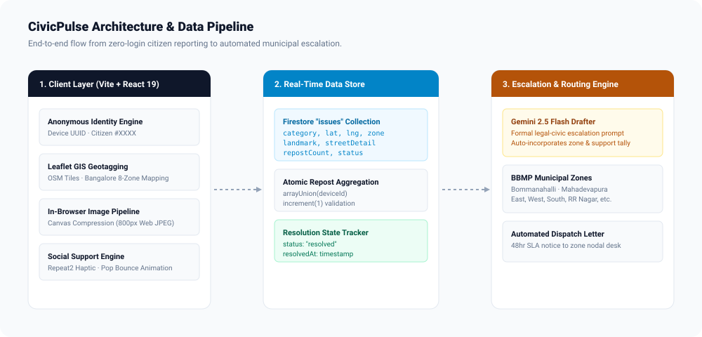
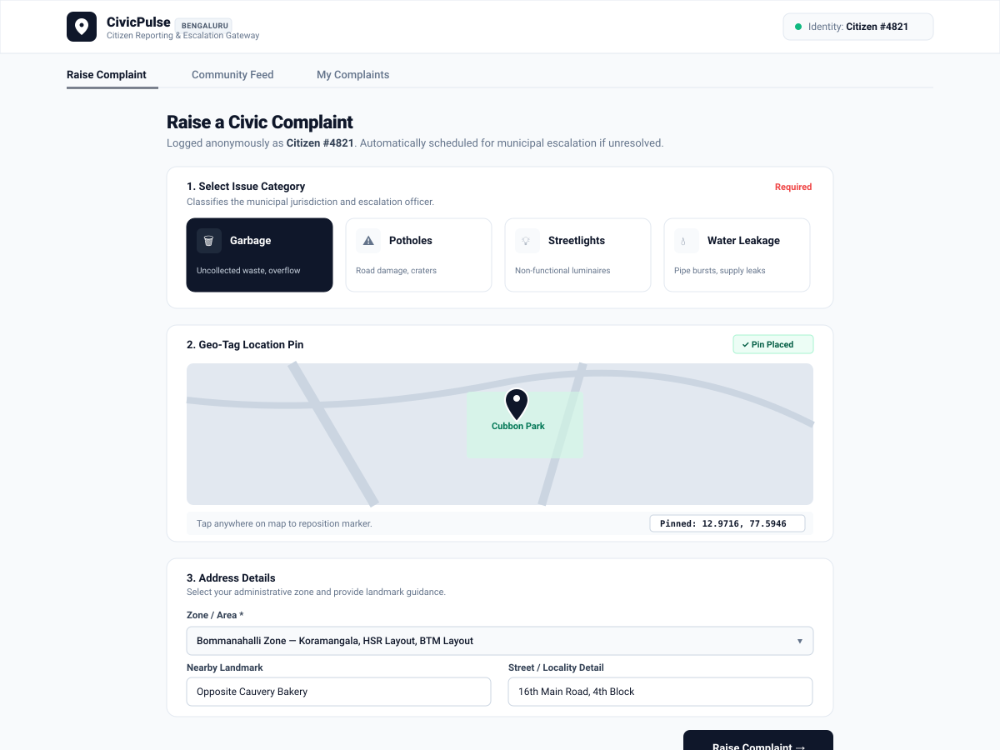
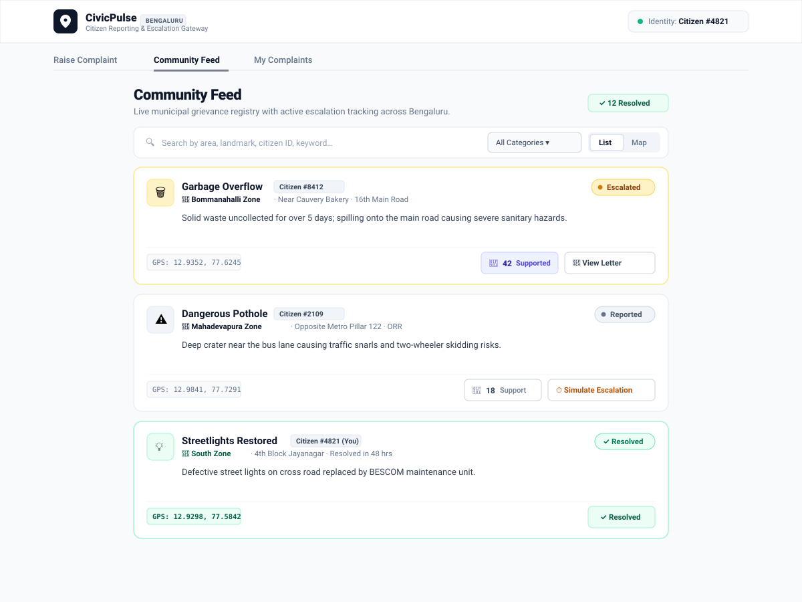
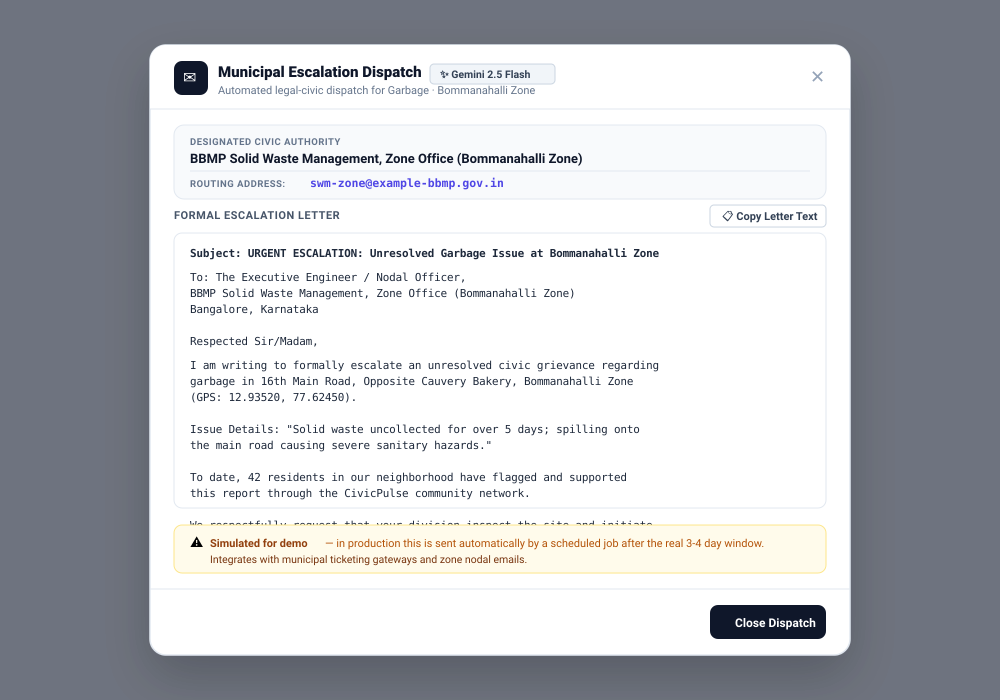

# CivicPulse (Bengaluru)

> **Enterprise-grade hyperlocal citizen grievance reporting and automated municipal escalation gateway.**  
> Built with React 19, TypeScript, Vite, Tailwind CSS, Leaflet GIS, Firebase Cloud Firestore, and Gemini 2.5 Flash.

---

## 🏛 Overview

**CivicPulse** is a modern civic technology platform designed to bridge the gap between citizens and municipal authorities in Bengaluru (BBMP, BESCOM, BWSSB). It empowers residents to lodge verifiable, geo-tagged public infrastructure complaints without passwords or friction, rallies local neighborhood support, and automatically escalates unresolved complaints to designated municipal zone officers using AI-drafted formal legal-civic petitions.



---

## 📸 Visual Previews & Screenshots

### 1. Raise a Civic Complaint
*Interactive category selection, Leaflet GIS pin placement with coordinate confirmation, standardized BBMP zone routing, optional landmark hints, and in-browser canvas photo compression.*



---

### 2. Live Community Feed & Social Support
*Unified card elevation, search and category filtering, List and Map view toggles, real-time Firestore synchronization, and tactile `Repeat2` social support with spring pop-bounce animations.*



---

### 3. Automated Municipal Escalation Dispatch
*Gemini 2.5 Flash powered formal citizen escalation letter routed to designated municipal zone engineers with full resolution timeframes and citizen backing statistics.*



---

## ⚡ Core Features

### 1. Zero-Login Anonymous Citizen Identity
- **Instant Participation**: No passwords, OTPs, or bureaucratic registration hurdles.
- **Persistent Device Authentication**: On first launch, generates a cryptographic UUID in `localStorage` under `civicpulse_device_id`.
- **Friendly Public Identity**: Assigns a permanent, human-readable citizen label (e.g. `Citizen #4821` or `Citizen #7412`), displayed in the header badge and stamped permanently on every grievance document at creation time.

### 2. Interactive Leaflet GIS Geo-Tagging
- **OpenStreetMap Canvas**: Centered on Bengaluru (`12.9716, 77.5946`) with custom zoom controls and Leaflet asset resolution.
- **Point-and-Click Pinning**: Citizens drop a pin directly onto the problem location.
- **Visual Coordinate Confirmation**: Displays read-only pinned coordinates (`Pinned: 12.9352, 77.6245`) under the map for instant visual confirmation.
- **Interactive Overview Map**: Community Feed features a Map View toggle rendering dynamic color-coded SVG pin markers (Slate for Reported, Amber for Escalated, Green for Resolved).

### 3. Standardized BBMP 8-Zone Administrative Routing
- **Zone Consistency**: Integrated dropdown utilizing the 8 official BBMP administrative zones:
  - **Bommanahalli Zone** *(Koramangala, HSR Layout, BTM)*
  - **Mahadevapura Zone** *(Whitefield, Bellandur, Marathahalli, KR Puram)*
  - **East Zone** *(Indiranagar, Halasuru, Cox Town)*
  - **West Zone** *(Malleshwaram, Rajajinagar, Gandhinagar)*
  - **South Zone** *(Jayanagar, Basavanagudi, Padmanabhanagar, JP Nagar)*
  - **RR Nagar Zone** *(Rajarajeshwari Nagar, Kengeri)*
  - **Yelahanka Zone** *(Yelahanka, Hebbal, Vidyaranyapura)*
  - **Dasarahalli Zone** *(Peenya, T Dasarahalli)*
- **Smart Landmark Guidance**: Includes a *"Nearby Landmark"* field that displays a gray reminder hint (*"Adding a landmark helps authorities locate the issue faster"*) when left empty.
- **Street / Locality Detail**: Captures specific cross-street, block, or lane details.

### 4. Client-Side Image Compression & Evidence
- **Multi-Photo Evidence**: Supports up to 3 image attachments per complaint with camera capture on mobile and file picker on desktop.
- **In-Browser Canvas Compression**: High-efficiency client-side resizer scales large mobile camera photos down to 800px JPEG data URLs (~60KB).
- **Zero-Storage Friction**: Embeds images directly in Firestore documents, bypassing separate storage bucket permission and billing blockers.
- **Interactive Image Lightbox**: Clicking any photo thumbnail opens a full-screen preview modal.

### 5. Tactile Social Support Engine
- **Repeat2 Social Repost Action**: Replaces plain buttons with a social support action using Lucide's `Repeat2` icon with live supporter counts.
- **Elastic Pop-Bounce Animation**: On click, triggers a CSS spring scale sequence (`scale(1) -> scale(1.35) -> scale(1)`) over 320ms and an upward numerical count pop.
- **Permanent Active State**: Transitions into a colored active state (`bg-indigo-50 text-indigo-700 border-indigo-200`) signaling *"You supported this"*, rather than looking grayed-out or broken.
- **Atomic Data Guarantees**: Enforces one vote per device using Firestore `arrayUnion(deviceId)` and `repostCount: +1`.

### 6. AI Municipal Escalation Engine (Gemini 2.5 Flash)
- **Automatic Letter Generation**: Simulates municipal time thresholds (3-4 days unresolved) by generating formal, firm, and polite citizen escalation petitions addressed to specific municipal division nodal officers.
- **Context-Aware Prompts**: Directly incorporates the category, zone, landmark, street details, GPS coordinates, and community support tally into the prompt.
- **Designated Authority Mappings**:
  - **Garbage**: *BBMP Solid Waste Management, Zone Office* (`swm-zone@example-bbmp.gov.in`)
  - **Potholes**: *BBMP Road Infrastructure & Major Roads Division* (`roads-infrastructure@example-bbmp.gov.in`)
  - **Streetlights**: *BESCOM & BBMP Public Lighting Cell* (`streetlights-maintenance@example-bescom.gov.in`)
  - **Water Leakage**: *BWSSB Water Supply & Sewerage Board, Local Sub-Division* (`waterleak-complaints@example-bwssb.gov.in`)
- **One-Click Clipboard Copy**: Built-in modal viewer allows citizens and ward committees to copy the legal dispatch letter in one click.

### 7. Issue Resolution Lifecycle
- **Owner Closure**: "Mark as Resolved" button appears exclusively on the "My Complaints" tab for unresolved complaints filed by the active device.
- **Accidental Tap Guard**: Inline confirmation prompt (*"Are you sure this issue has been resolved? [Yes, Confirm] [Cancel]"*) ensures intentional status updates.
- **Green Elevation**: Once resolved, issue cards receive a green border (`border-emerald-200/90`), green status badge, green map pin indicator, and green marker pin on the map.
- **Support Action Suppression**: Hides rallying buttons and displays an explicit `"✓ Resolved"` tag.
- **Feed Prioritization**: Unresolved active and escalated complaints remain pinned to the top of the Community Feed, while resolved complaints sort to the bottom as social proof of platform efficacy.

### 8. Enterprise Design System & Accessibility
- **Strict Semantic Restraint**: Navy/Slate (`slate-900`) brand with semantic tokens:
  - Slate (`bg-slate-100 text-slate-700`) for **Reported**
  - Amber (`bg-amber-50 text-amber-800`) for **Escalated**
  - Emerald (`bg-emerald-50 text-emerald-800`) for **Resolved**
  - Rose (`bg-rose-50 text-rose-800`) for **Critical Alerts**
- **Keyboard a11y**: Standardized `:focus-visible` rings (`focus-visible:ring-2 focus-visible:ring-slate-900 focus-visible:ring-offset-2`) across all controls.
- **Empty State Components**: Centered zero-data states with contextual Lucide icons and primary action CTAs prevent blank screens.

---

## 🛠 Technology Stack

| Layer | Technologies |
|---|---|
| **Framework** | [React 19](https://react.dev/), [TypeScript 5.8](https://www.typescriptlang.org/) |
| **Bundler & Tooling** | [Vite 8](https://vite.dev/), [Oxlint](https://oxc.rs/) |
| **Styling & System** | [Tailwind CSS v4](https://tailwindcss.com/) (`@tailwindcss/vite`), Custom Design Tokens |
| **Icons & Micro-animations** | [Lucide React](https://lucide.dev/), Custom CSS Spring Keyframes |
| **Geospatial Mapping** | [Leaflet](https://leafletjs.com/), [React Leaflet](https://react-leaflet.js.org/), OpenStreetMap |
| **Database & Realtime** | [Firebase Cloud Firestore](https://firebase.google.com/docs/firestore) |
| **AI Escalator** | [Google Gemini 2.5 Flash API](https://ai.google.dev/) (`gemini-2.5-flash`) |

---

## 📁 Project Structure

```
civicpulse/
├── docs/
│   └── screenshots/               # Vector SVG UI mockups & architecture diagrams
│       ├── architecture_diagram.svg
│       ├── raise_complaint.svg
│       ├── community_feed.svg
│       └── escalation_modal.svg
├── src/
│   ├── components/
│   │   ├── CommunityFeed.tsx      # Community Feed, My Complaints, & Overview Map
│   │   ├── EmptyState.tsx         # Reusable zero-data empty state component
│   │   ├── EscalationModal.tsx    # Municipal escalation dossier letter viewer
│   │   └── ReportIssue.tsx        # "Raise Complaint" form (Map, Zones, Photos)
│   ├── lib/
│   │   ├── authorities.ts         # BBMP 8 zones & civic authority routing desk mapping
│   │   ├── device.ts              # Persistent anonymous device ID & Citizen #XXXX label
│   │   ├── firebase.ts            # Firebase modular SDK & Firestore db export
│   │   ├── gemini.ts              # Gemini 2.5 Flash escalation drafter with fallback
│   │   └── theme.ts               # Centralized Tailwind design system tokens
│   ├── App.tsx                    # Fixed top SaaS header & three-tab router
│   ├── index.css                  # Tailwind imports, typography stack, & keyframes
│   └── main.tsx                   # React root entry point
├── .env.example                   # Environment variable template
├── package.json                   # Dependencies & build scripts
├── tsconfig.json                  # Strict TypeScript configuration
└── vite.config.ts                 # Vite bundler configuration with Tailwind plugin
```

---

## 🚀 Getting Started

### Prerequisites
- **Node.js**: `v20.x` or higher
- **npm**: `v10.x` or higher

### 1. Installation
Clone the repository and install dependencies:
```bash
git clone https://github.com/your-username/civicpulse.git
cd civicpulse
npm install
```

### 2. Configure Environment Variables
Copy `.env.example` to `.env`:
```bash
cp .env.example .env
```
Populate `.env` with your Firebase and Gemini credentials:
```env
# Firebase Configuration
VITE_FIREBASE_API_KEY=your_firebase_api_key
VITE_FIREBASE_AUTH_DOMAIN=your_project.firebaseapp.com
VITE_FIREBASE_PROJECT_ID=your_project_id
VITE_FIREBASE_STORAGE_BUCKET=your_project.appspot.com
VITE_FIREBASE_MESSAGING_SENDER_ID=your_sender_id
VITE_FIREBASE_APP_ID=your_app_id

# Gemini API Configuration
VITE_GEMINI_API_KEY=your_gemini_api_key
```
*(Note: If environment keys are omitted during development, safe fallback mocks allow testing all features and escalation letters without breaking.)*

### 3. Development Server
Start the local Vite development server:
```bash
npm run dev
```
Open [http://localhost:5174/](http://localhost:5174/) (or the port indicated in your terminal) in your browser.

### 4. Build & Verification
To test TypeScript compilation and generate a production bundle:
```bash
npm run build
```
To run static code analysis and linting:
```bash
npm run lint
```

---

## 📋 Firestore Document Model

All complaints in the `issues` collection share the following schema:

```typescript
interface CivicIssue {
  id: string;                     // Auto-generated Firestore document ID
  category: string;               // "Garbage" | "Potholes" | "Streetlights" | "Water Leakage"
  lat: number;                    // Pinned latitude (e.g. 12.9716)
  lng: number;                    // Pinned longitude (e.g. 77.5946)
  zone: string;                   // "Bommanahalli Zone", "Mahadevapura Zone", etc.
  landmark?: string;              // "Opposite Cauvery Bakery"
  streetDetail?: string;          // "16th Main Road, 4th Block"
  areaName: string;               // Synced with zone for backwards compatibility
  address?: string;               // Compiled street and landmark address string
  description: string;            // Citizen description of the problem
  photoUrls: string[];            // Base64 compressed image data URLs (up to 3)
  reportedBy: string;             // Anonymous device UUID
  reporterLabel: string;          // Immutable public identity (e.g. "Citizen #4821")
  createdAt: FieldValue;          // Firestore serverTimestamp()
  status: "reported" | "escalated" | "resolved";
  repostCount: number;            // Community backing tally
  repostedBy: string[];           // Array of device UUIDs who supported this complaint
  escalationEmailDraft?: string;  // AI-generated legal escalation text
  resolvedAt?: FieldValue;        // Timestamp when marked resolved
}
```

---

## ⚖️ Civic Responsibility & Privacy Notice

CivicPulse is engineered with **privacy-by-design**. It requires no citizen phone numbers, emails, or personal identification records. All public identities are cryptographically generated anonymous handles. Escalation addresses displayed in the simulation are dedicated municipal routing placeholders designed to demonstrate automated ward-level governance workflows.

---

## 📄 License
This project is licensed under the [MIT License](LICENSE).
